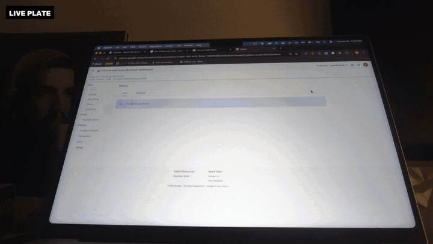
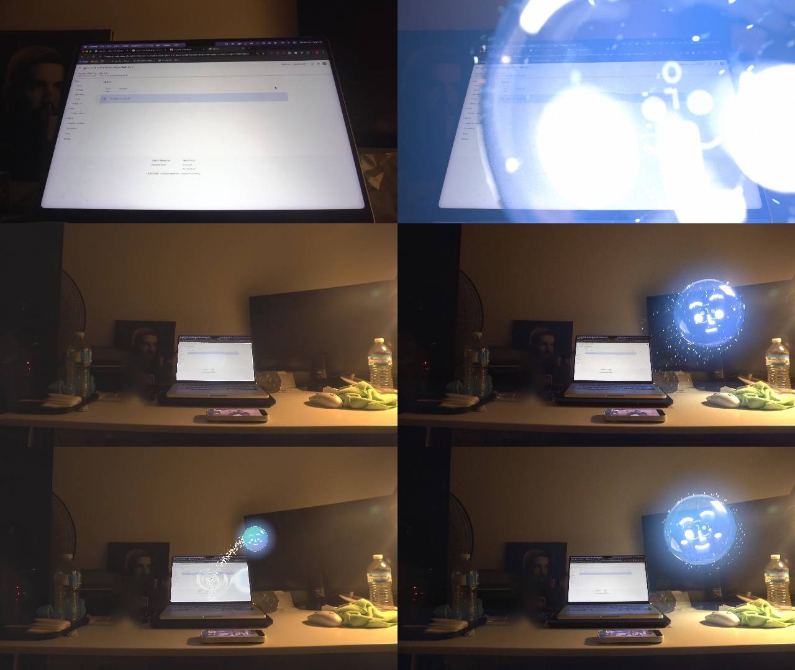
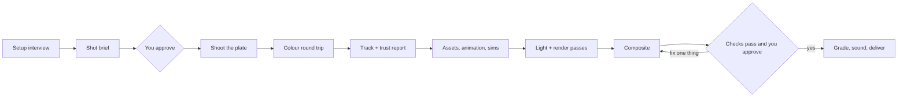

# Blender VFX Skill

**Turn your AI agent into a VFX artist that works like a studio: it interviews you, plans the shot, asks before anything expensive, and checks its own work.**



*One handheld shot, two laptops: live plate, 3D layout, CG render, final composite. [Watch the full breakdown](media/iris_breakdown.mp4).*

## Same agent, same idea. Without the skill vs with it.



Left: the agent on its own. A flat sticker that lights nothing. Right: the same agent following this skill. A glass character that glows, lights the room, sits at the right depth and holds up next to real footage.

## What you get

- **An interview, not a guess.** One setup chat about your camera, lens, picture profile and computers, saved so you never answer twice. Then a short brief for every shot, with checks you approve before anything is built.
- **Gates before anything costly.** It stops and asks before long renders, simulation bakes, the final render, overwriting your files or buying assets.
- **The whole shot, plate to delivery.** Shooting tips for VFX, log footage and colour round trips, camera tracking with a trust report, set rebuild, assets, animation, simulation, lighting to match, render passes, compositing, grading, 16:9 and 9:16 exports, festival masters.
- **Faster renders without losing quality.** A render doctor finds what is slow in your scene and marks which fixes are safe. Plus tuning for macOS, Windows and Linux.
- **Ten ready recipes.** Energy blades, muzzle flashes, creatures, explosions, splits, sky swaps and day for night, removals, set extensions, flybys, water.
- **Clean project folders.** A layout anyone can read, and rules that stop the agent leaving copies, temp files and debug frames everywhere.
- **Cheap on tokens.** A short core file that loads one guide at a time, compact scene probes instead of dumps, and one contact sheet instead of fifty screenshots.
- **It learns your habits.** Every finished shot adds a line to `lessons.md`, so the next shot starts smarter.
- **Drives DaVinci Resolve too**, including the free edition through a Lua bridge.

## Quick start

**Claude (app or desktop):** zip `skills/blender-vfx` and upload it in the Skills section of settings.

**Claude Code:**

```
/plugin marketplace add AryannDhingraa/blender-vfx-skill
/plugin install blender-vfx@blender-vfx-skill
```

Or copy `skills/blender-vfx` into `~/.claude/skills/`.

**Codex, Cursor, Gemini CLI and other agents that read SKILL.md:** copy the folder into the agent's skills folder.

Then just ask: *"Put a glowing portal on the wall behind me in this clip."* The skill takes it from there.

**Works best with** Blender 4.2+ (tested on 5.3), a Blender MCP connection so the agent can drive Blender directly, and `ffmpeg`.

## How a shot flows



## The toolbox

| Script | What it does |
| --- | --- |
| `probe_scene.py` | Whole scene in one compact line |
| `track_report.py` | Tells you if a camera solve can be trusted, not just its error number |
| `render_doctor.py` | Finds what makes a render slow, ranked, with quality risk per fix |
| `setup_shot.py` | Builds the project folders, camera, colour and render settings for your hardware |
| `contact_sheet.py` | Cheap preview frames tiled into one image |
| `verify_output.py` | Missing, black or flickering frames, wrong frame counts |
| `tidy_project.py` | Clutter, temp files and exact duplicates |
| `vfx_engine/analyse_footage.py` | Reads your plate first: locked, rotating or real parallax, blur, exposure, and which solve to use |
| `vfx_engine/run_job.py` | Runs Blender headless with a timeout and proves the frames were actually written |

## Project layout it creates

```
MyFilm/
  README.md      00_brief/   01_source/   02_plates/   03_track/   04_assets/
  05_blend/      06_cache/   07_renders/  08_comp/     09_deliver/
  scripts/       logs/       _review/     _tmp/        _archive/
```

## Roadmap

- Multi-engine tracking with automatic comparison of solves
- AI masks for actors and foreground objects
- Checkpoints and automatic recovery for headless jobs
- A 20-shot benchmark ([test list](docs/test-shots.md)) so every change is measured
- Rendering beyond one machine ([options](docs/cloud-rendering.md))

## Honest limits

- Ocean-scale water and city-sized explosions need heavier tools or stock footage. The skill says so instead of faking it.
- Settings are starting points. Your first real shot shows what to tune.
- The agent can only drive apps it can connect to.

## Contributing

Issues and pull requests are welcome: camera notes for your model, render timings before and after, new recipes, and test prompts in `evals/evals.json`. Keep `SKILL.md` short and put detail in the stage guides.

## Licence

MIT
