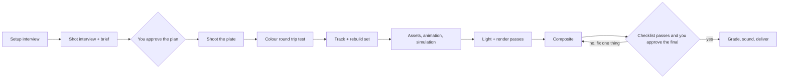

# Blender VFX skill

A skill that turns an AI agent (Claude, or any agent that reads `SKILL.md`) into a careful VFX partner for Blender. It interviews you about your camera, computer and shot, plans the work, asks before anything slow or risky, and follows the same steps working VFX artists use to put CG into real footage.

Built for indie filmmakers, YouTubers and students who shoot their own plates and want results that hold up next to the reference shot, on ordinary laptops.

## What it does

- **Interviews you first.** A one-time setup interview (camera, picture profile, lens, computers, software, delivery formats) saved to `vfx-profile.md`, then a short interview for every shot. It never asks the same setup question twice.
- **Asks before it costs you.** Approval gates before long renders and bakes, before the final render, before overwriting your files, before paid assets.
- **Covers the whole shot.** Shooting the plate, log footage and colour round trips, camera tracking, assets, animation, simulation, lighting to match, render passes, compositing, grading, 16:9 and 9:16 delivery, festival masters, asset licences.
- **Adapts to your gear.** Settings for Apple Silicon, NVIDIA RTX, low-VRAM GTX cards and CPU-only machines, plus a two-machine render setup with Flamenco.
- **Saves tokens.** A short `SKILL.md` that loads one stage guide at a time, a compact scene probe instead of scene dumps, a running shot log instead of re-inspection, low-resolution checkpoints instead of constant screenshots.
- **Makes renders faster.** A read-only render doctor ranks what slows a scene down and marks which fixes risk quality, plus a guide to tuning Blender and the computer itself (macOS, Windows, Linux).
- **Ready-made recipes.** Ten short plans for common shots: muzzle flashes, energy blades, creatures, explosions, splits and destruction, sky swaps and day for night, removals, set extensions, flybys, water interaction.
- **Drives DaVinci Resolve too.** Routes for Studio and for the Free edition (Lua bridge), with rules for safe automation.
- **Learns your habits.** A `lessons.md` file collects what worked on your shots, so the agent plans better each time without retraining.
- **Keeps your folders clean.** A standard project layout a person can read at a glance, rules that stop the agent scattering scripts, temp files and debug frames, and a tidy script that finds clutter and byte-identical duplicates.
- **Checks its own work.** Contact sheets, a shot checklist, acceptance checks with numbers, and a script that finds missing, black or flickering frames.

## The pipeline



## Install

**Claude (claude.ai or the desktop app):** zip the `skills/blender-vfx` folder and upload it in the Skills section of Claude's settings.

**Claude Code:** copy `skills/blender-vfx` into `~/.claude/skills/` (all projects) or `.claude/skills/` in one project. Or add this repo as a plugin marketplace:

```
/plugin marketplace add AryannDhingraa/blender-vfx-skill
/plugin install blender-vfx@blender-vfx-skill
```

**Other agents (Codex, Cursor, Gemini CLI and others that read SKILL.md):** copy the `skills/blender-vfx` folder into the agent's skills folder.

### Works best with

- Blender 4.2 or newer (scene probe tested on 5.3).
- A Blender MCP connection so the agent can drive Blender directly (Blender's official MCP or the community `blender-mcp` add-on). Without one, the agent writes scripts you run.
- `ffmpeg` and `ffprobe` for `verify_output.py`.

## First run

Ask the agent for any Blender VFX task. It looks for `vfx-profile.md`; if none exists, it runs the setup interview (about 5 short rounds of multiple choice questions) and saves your answers. Every shot after that starts with a short shot interview and a written brief you approve.

## Layout

```
skills/blender-vfx/
  SKILL.md                    workflow, approval gates, token rules, stage map
  references/
    00-setup-interview.md     one-time questions and profile
    01-shot-brief.md          per-shot questions, composite strategy, acceptance checks
    02-shooting-the-plate.md  camera settings for VFX, log, stabilisation, zoom lenses
    03-color-pipeline.md      log to Blender and back, round trip test
    04-tracking.md            camera solve, set rebuild, hard cases
    05-assets-materials.md    sourcing, import checks, PBR, digital doubles
    06-animation.md           mocap, creatures, physics vs keys
    07-simulation.md          destruction, Mantaflow, water, budgets
    08-lighting-rendering.md  matching light, passes, render settings
    09-compositing.md         integration order, day for night, giveaways
    10-finishing-delivery.md  grade, sound, 16:9 and 9:16, masters, licences
    11-hardware.md            tiers, speedups, memory, Flamenco
    12-review-checklist.md    review loop and shot checklist
    13-resolve-automation.md  Resolve Studio and Free routes, safe automation
    14-render-speed.md        faster renders without quality loss, computer tuning
    15-project-structure.md   folder layout and file hygiene rules
    video-index.md            learning links
  recipes/                    10 plans for common effects
  templates/                  vfx-profile.md, shot-log.md, asset-licenses.md, lessons.md
  scripts/
    probe_scene.py            compact JSON scene summary (run inside Blender)
    render_doctor.py          read-only render speed check with ranked fixes
    setup_shot.py             folders, camera, colour, Cycles tier defaults, versioned save
    contact_sheet.py          cheap preview frames tiled into one image
    verify_output.py          frame count, gaps, black frames, flicker spikes
    tidy_project.py           clutter, temp files and duplicate finder (deletes only with flags)
evals/evals.json              test prompts to check changes to the skill
```

## Project layout it creates

```
MyFilm/
  README.md      00_brief/   01_source/   02_plates/   03_track/   04_assets/
  05_blend/      06_cache/   07_renders/  08_comp/     09_deliver/
  scripts/       logs/       _review/     _tmp/        _archive/
```

## How it differs from other Blender skills

Checked November 2026 from each project's public pages.

| Project | Focus | What this skill adds |
| --- | --- | --- |
| [arjun988/blender-skills](https://github.com/arjun988/blender-skills) | 94 skills for modelling, styles and game assets, with a router skill | Live action plates: tracking, plate colour, shadow catching, integration compositing, shooting advice |
| [howells/skills `blender`](https://www.skills.sh/howells/skills/blender) | Safe live vs headless Blender control, response paging | A full VFX workflow and user interviews on top of the same safety rules |
| [randroids-dojo `blender-production`](https://www.skills.sh/randroids-dojo/skills/blender-production) | Brief to measurable checks, session verification | VFX-specific checks (solve error, black levels, grain, contact) and camera advice |
| [sideshowroberto/vfx-agent-toolkit](https://github.com/sideshowroberto/vfx-agent-toolkit) | Many apps (Nuke, Houdini, Unreal, Blender) | Depth on the Blender live action path and low-end hardware |
| [calesthio `vfx-compositing`](https://skills.rest/skill/vfx-compositing) | App-agnostic compositing brief and QA | Hands-on Blender steps from plate to delivery |

Ideas borrowed with thanks: live vs headless routes and response paging (howells), measurable acceptance checks and a scene probe (randroids-dojo), a router to smaller guides and a validation gate (arjun988), composite strategy choice and delivery-size QA (calesthio).

## Inspiration

The workflow follows the methods shown in [ErikDoesVFX](https://www.youtube.com/@erikdoesvfx)'s shot recreations (which use Houdini and Nuke; this skill gives the Blender equivalents) and the realism rules in Lume Media's [Claude 3D experiment](https://www.youtube.com/watch?v=bIFgfkTdrJo). Not affiliated with either.

## Honest limits

- Ocean-scale water and city-scale explosions need Houdini-class tools or stock elements. The skill says so instead of faking it.
- Settings are starting points. Your first real shot will show what to tune; open an issue with what you changed.
- The agent can only drive apps it has a connection to. Some free editions block automation (recent DaVinci Resolve Free versions removed external Python scripting).

## Making it better

Agents are not retrained by a skill; they get better from better instructions and evidence. Ways to help:

- **Lessons:** share anonymised lines from your `lessons.md` in an issue.
- **Camera notes:** bit depth, crop modes, stabilisation and lens quirks for your exact camera model.
- **Recipes:** a new effect plan, kept short, with checks.
- **Hardware results:** before and after render times with the settings you changed.
- **Evals:** add a case to `evals/evals.json` for any behaviour you want guaranteed, and run the cases before opening a pull request.

## Contributing

Issues and pull requests welcome, especially camera notes for specific models, hardware results, and fixes from real shots. Keep files plain ASCII markdown, keep `SKILL.md` short, and put detail in the stage files.

## Licence

MIT
